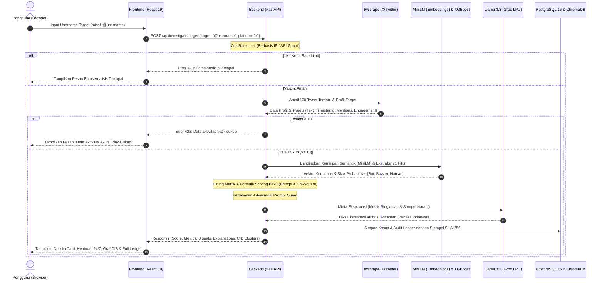
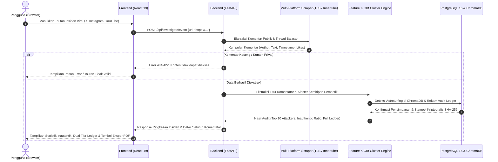
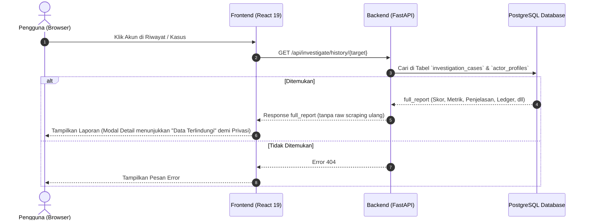

<p align="center">
  
</p>

# 🛡️ Axiom — Cognitive Domain Threat Intelligence & Inauthentic Behavior Detection Platform

[](LICENSE)
[](CONTRIBUTING.md)
[](SECURITY.md)
[](https://github.com/AcademyCity-RND/AC-ProjectAxiom/actions/workflows/ci.yml)
[](https://github.com/AcademyCity-RND/AC-AxiomCore)
[](CITATION.cff)
[](https://github.com/AcademyCity-RND/AC-ProjectAxiom/actions)
[](https://www.python.org/)
[](https://fastapi.tiangolo.com/)
[](https://vitejs.dev/)
[](https://react.dev/)
[](https://kartikacyberhackathon.id/)

> **Kategori:** 04 Cognitive Domain (Siber Sosial)  
> **Institusi:** Pusat Siber TNI Angkatan Darat (PUSSIBERAD) & CODEPOLITAN  
> **Status:** MVP Prototype Development (Target Submission: 15 November 2026)  
> **Core Engine:** [Axiom-Core](https://github.com/AcademyCity-RND/AC-AxiomCore) (*Open-Source Threat Profiling & Inauthentic Behavior Detection Engine*)

---

## 🎯 Gambaran Umum (Executive Overview)

### Filosofi Axiom
"Aksioma" (Axiom) mencerminkan kebenaran dasar yang tidak perlu dibuktikan lagi. Project Axiom bertujuan menjadi landasan absolut dalam menemukan fakta di tengah kebisingan disinformasi, kampanye buzzer, dan manipulasi kognitif di ruang siber. Kami percaya bahwa di balik setiap narasi terkoordinasi, terdapat jejak perilaku yang dapat diverifikasi secara empiris.

### Tagline
*"Unveiling the Truth in the Cognitive Battlefield."*

**Axiom** adalah platform intelijen forensik siber sosial yang dirancang untuk mendeteksi, mengklasifikasikan, dan memetakan aktor inautentik (**Bot**, **Buzzer/Astroturfer**, dan **Manusia Autentik**) serta operasi pengaruh (*Psychological Operations / PsyOps*) di media sosial secara *real-time*, berbasis bukti (*Explainable AI*), dan mandiri tanpa biaya API eksternal.

Sistem ini mentransformasi proses investigasi manual yang memakan waktu berhari-hari menjadi analisis otomatis dalam hitungan detik, memberikan atribusi ancaman nyata bagi pertahanan kedaulatan informasi nasional.

> [!NOTE]
> 🔬 **Ditenagai oleh Engine Riset Mandiri: [Axiom-Core](https://github.com/AcademyCity-RND/AC-AxiomCore)**  
> Seluruh fondasi matematis 21 fitur behavioral ($H_{norm}$ Shannon temporal entropy, $\chi^2$ uji sirkadian 24/7, parameter burstiness $B$), pipeline klasifikasi tri-class XGBoost, filter pertahanan *Adversarial Prompt Guard*, dan harvester data multi-kanal ditenagai oleh framework riset mandiri kami: **[Axiom-Core](https://github.com/AcademyCity-RND/AC-AxiomCore)**. Dokumentasi teknis dan formulasi ilmiah lengkap dapat dipelajari di [Spesifikasi Framework Axiom-Core](docs/AXIOM_CORE_FRAMEWORK.md).

---

## ⚡ Fitur Utama (Core Capabilities)

1. **Target Actor Profiling (X / Twitter Engine):**
   - Investigasi mendalam riwayat akun `@username`: tweet orisinal, replies, reposts, dan jejaring interaksi via `twscrape` (1 akun burner aman via cookies browser tanpa risiko banned).
2. **Multi-Platform Event & Incident Auditing:**
   - Deteksi amplifikasi terkoordinasi pada konten viral lintas platform:
     - **X (Twitter):** Cuitan tunggal & seluruh pohon balasan (*replies*).
     - **Instagram:** Feed Post (`/p/`) & Reels (`/reel/`) via **Multi-Tier Zero-Auth Architecture**:
       - **Tier 1 (Microservice Scraper):** Ekstraksi live hingga 400 komentar utama tanpa login & tanpa risiko banned via browser TLS impersonation (`curl_cffi`).
       - **Tier 2/3 (Authenticated Session):** Penelusuran pohon balasan (*threaded replies*) opsional jika sesi akun burner (`INSTAGRAM_SESSIONID`) disediakan.
       - **Tier 4 (Contextual Forensics Fallback):** Fail-safe anti-crash cerdas berbasis konteks nyata postingan.
     - **YouTube:** Video Panjang (`/watch`) & Shorts (`/shorts/`) via streaming parser Innertube HTTP.
3. **Tri-Class AI Classification Engine:**
   - Membedakan tiga entitas dengan presisi tinggi menggunakan XGBoost Classifier:
     - **Bot (Automated):** Skrip terjadwal, entropi waktu rendah, minim variasi kata.
     - **Buzzer (Astroturfer):** Akun manusia/semi-otomatis dengan pola jam kerja terstruktur (08.00–18.00 WIB) dan konsentrasi narasi ekstrem pada figur/isu tertentu.
     - **Manusia (Autentik):** Pola sirkadian alami, minat heterogen, interaksi sosial organik.
4. **Coordinated Inauthentic Behavior (CIB) Cluster Mapping:**
   - Visualisasi graf interaktif (React Flow / Cytoscape) yang memetakan keterkaitan antar-akun yang menyebarkan narasi parafrase serupa dalam jendela waktu sempit via ChromaDB vector similarity (`all-MiniLM-L6-v2`).
5. **Circadian 24/7 Heatmap & Temporal Entropy:**
   - Visualisasi jadwal aktif mingguan (24x7 matrix & uji Chi-Square goodness-of-fit) untuk mendeteksi jam kerja buzzer bayaran vs operasional bot 24 jam nonstop.
6. **Explainable AI (XAI) Threat Attribution & Prompt Defense:**
   - Menggunakan Llama 3.3 70B (via Groq LPU) untuk menghasilkan poin-poin pembuktian logis (*evidence points*) mengapa akun dicap berbahaya.
   - Dilengkapi *Adversarial Prompt Guard* (`[REDACTED_CONTROL_TOKEN]`) anti-jailbreak dari komentar bot/buzzer.
7. **Dual-Tier Forensic Ledger & Dossier Export:**
   - Tabel ringkasan Top 10 Attackers serta Audit Ledger 100% seluruh komentator.
   - Ekspor berkas dossier resmi siap cetak (A4 PDF/HTML dengan kop dinas PUSSIBERAD) disertai rantai bukti kriptografis (*Digital Chain of Custody* SHA-256).
8. **Research Dataset Harvester (RFC 4180):**
   - CLI Tooling mandiri dengan **arsitektur paralel 6-worker simultan** untuk ekstraksi dataset riset empiris aktual di 6 skenario (X User, X Tweet, IG Post, IG Reels, YT Shorts, YT Video) berstandar RFC 4180 dengan fitur auto-resume, checkpoint, dan sinkronisasi 2-arah cerdas (`Sync-NewerFile`).

---

## 🏗️ Arsitektur Sistem (High-Level Architecture)

```
┌────────────────────────────────────────────────────────┐
│          FRONTEND DASHBOARD (Vite + React 19)          │
│  - Target Search (@user / Event URL)  - React Flow     │
│  - 24/7 Circadian Heatmap             - Dual-Tier Ledger│
│  - Forensic Dossier Card (SHA-256)    - Export A4/CSV  │
└───────────────────────────┬────────────────────────────┘
                            │ (REST / JSON)
                            ▼
┌────────────────────────────────────────────────────────┐
│             CORE BACKEND API (FastAPI Async)           │
│  - Investigation Orchestrator     - Event Orchestrator │
│  - Rate Limiting Middleware       - Anti-SSRF Guard    │
└──────┬────────────────────┬────────────────────┬───────┘
       │                    │                    │
       ▼                    ▼                    ▼
┌──────────────────────┐ ┌──────────────┐ ┌──────────────┐
│ MULTI-PLATFORM ENGINE│ │ VECTOR STORE │ │ AI / ML CORE │
│ - X (twscrape)       │ │ - ChromaDB   │ │ - XGBoost    │
│ - Instagram Scraper  │ │   (MiniLM)   │ │ - Groq Llama │
│   (Zero-Auth Service)│ │              │ │   3.3 (XAI)  │
│ - YouTube (Innertube)│ │              │ │              │
└──────────────────────┘ └──────────────┘ └──────────────┘
       │                    │                    │
       └────────────────────┴────────────────────┘
                            │
                            ▼
┌────────────────────────────────────────────────────────┐
│            PERSISTENCE (PostgreSQL 16)                 │
│  - Investigation Cases  - Actor Profiles  - Audit Trail│
└────────────────────────────────────────────────────────┘
```

---

## 🔄 Alur Kerja Sistem (System Workflows)

Berikut adalah visualisasi alur kerja interaksi komponen sistem dalam mendeteksi dan memproses intelijen ancaman kognitif:

### Diagram Alur Analisis Baru (Request Flow)
Berikut adalah visualisasi alur request ketika pengguna melakukan analisis akun baru:



### Diagram Alur Audit Konten / Insiden Viral (Event Auditing Flow)
Berikut adalah alur saat pengguna mengaudit tautan postingan viral lintas platform (X Tweet, Instagram Post/Reels, YouTube Video/Shorts):



### Diagram Alur Mengambil Riwayat (History Flow)
Berikut adalah alur saat pengguna mengeklik akun dari papan riwayat investigasi / leaderboard (tanpa scraping ulang):



---

## 📂 Struktur Repositori (Repository Structure)

```text
axiom/
├── docs/                      # Dokumentasi Teknis & Panduan
│   ├── PRD-Axiom.md           # Product Requirements Document Acuan
│   ├── ROADMAP-CHECKLIST.md   # Master Roadmap & Checklist 4 Minggu
│   └── SCRAPING_DATA_FORMAT.md# Unified Scraping & AI Feature Specification
├── backend/                   # FastAPI Backend Service
│   ├── app/
│   │   ├── api/v1/endpoints/  # Route Handlers (investigate, network, export)
│   │   ├── core/              # Config, Security, Database Sessions
│   │   ├── models/            # SQLAlchemy DB Models
│   │   ├── schemas/           # Pydantic Schemas (Request/Response)
│   │   ├── templates/         # Jinja2 Dossier HTML Templates (@media print A4)
│   │   └── services/          # Core Engines:
│   │       ├── scraper/       # twscrape, instaloader, youtube adapters
│   │       ├── features.py    # 21-Feature Extractor (Temporal, Structural, Content)
│   │       ├── classifier.py  # XGBoost Tri-Class Bot Classifier & XAI
│   │       ├── embedder.py    # MiniLM-L6-v2 Local Vector Embedder
│   │       ├── vector_store.py# ChromaDB Client & CIB Cluster Detector
│   │       ├── llm_analyst.py # Groq Llama 3.3 Cognitive Analyst & Prompt Defense
│   │       ├── x_auditor.py   # X Profile & Tweet Replies Investigator
│   │       ├── instagram_auditor.py # IG Post & Reels Investigator
│   │       ├── youtube_auditor.py   # YT Video & Shorts Investigator
│   │       └── investigation_orchestrator.py # Pipeline Coordinator
│   ├── alembic/               # Database Migration Scripts
│   ├── tests/                 # 62/62 Unit & Integration Tests Passed
│   ├── Dockerfile             # Container Definition Backend
│   └── requirements.txt       # Locked Python Dependencies
├── frontend/                  # Vite + React 19 Web Dashboard
│   ├── src/
│   │   ├── components/        # Tactical Cyber Dark Theme Components
│   │   │   ├── common/        # InspectorDrawer, ThreatBadge, ErrorBoundary
│   │   │   ├── investigation/ # ActorSearchForm, Stepper, DossierCard
│   │   │   ├── visualization/ # NetworkGraph (React Flow), Heatmap, Entropy
│   │   │   └── reports/       # DualTierLedgerTable, ExportActionPanel
│   │   ├── stores/            # Zustand State Management (useCaseStore, useAuthStore)
│   │   └── services/api.ts    # Axios REST API Client Layer
│   ├── package.json           # Locked Dependencies (pnpm)
│   ├── tailwind.config.ts     # Cyber Defense Dark Palette (v4)
│   ├── vite.config.ts         # Vite Configuration & Backend Proxy
│   └── tsconfig.json          # TypeScript Config
│   ├── tools/                 # Operational & Research Tooling
│   │   ├── dataset_harvester/ # Standalone Harvester (RFC 4180 CSV)
│   │   │   ├── harvester.py   # Multi-Channel 6-Worker Parallel CLI Engine
│   │   │   └── targets.json   # 80 Verified Target Scenarios
│   │   ├── clean_database.py
│   │   └── dump_instagram_session.py
├── data/                      # Local Embedded Storage
│   ├── chromadb/              # Persistent Vector Collections
│   ├── models/                # Trained XGBoost Artifacts (xgboost_tri_class.json)
│   └── raw_datasets/          # Harvested Datasets (X, Instagram, YouTube)
├── docker-compose.yml         # Local Infrastructure Orchestration (4 Containers)
├── run_harvester.ps1          # One-Click Harvester Execution Script
├── .env.example               # Complete Environment Configuration Template
├── .gitignore                 # Sanitized Git Ignore (PII & Sessions Locked)
└── README.md                  # Project Overview (This File)
```

---

## 🚀 Panduan Instalasi & Menjalankan (Quick Start)

### 1. Prasyarat Sistem
- **Docker Desktop** (direkomendasikan) atau Docker Engine 24+
- **Python 3.11+** *(opsional, hanya jika ingin menjalankan backend manual tanpa Docker)*
- **Node.js 20+ & pnpm** *(opsional, hanya jika ingin menjalankan frontend manual tanpa Docker)*
- **Groq Cloud API Key** (Gratis 100% di [console.groq.com](https://console.groq.com))

---

### 2. Kloning & Konfigurasi `.env`

```bash
# 1. Kloning repositori
git clone https://github.com/AcademyCity-RND/AC-ProjectAxiom.git
cd AC-ProjectAxiom

# 2. Salin template konfigurasi
cp .env.example .env
```

Buka file `.env` di teks editor favorit (VS Code, Notepad, dll):
1. **Wajib:** Masukkan `GROQ_API_KEY=gsk_...` untuk modul analisis intelijen AI Llama 3.3.
2. **Kredensial Media Sosial (Untuk Live Scraping):**
   - **X (Twitter):** Masukkan `TWITTER_USERNAME`, `TWITTER_AUTH_TOKEN`, dan `TWITTER_CT0` *(didapat dari browser: `F12` -> `Application` -> `Cookies` -> `https://x.com`)*.
   - **Instagram:** Masukkan `INSTAGRAM_SESSIONID` *(didapat dari browser: `F12` -> `Application` -> `Cookies` -> `https://instagram.com`)*.
   - **YouTube:** Berjalan otomatis tanpa butuh login maupun API key.
3. **💡 Tips Pengujian Cepat Tanpa Akun Medsos:**  
   Jika belum memiliki akun burner medsos, Anda tetap bisa menguji seluruh fitur dashboard! Cukup setel `SCRAPER_OFFLINE_MODE=true` di `.env` atau klik tombol preset demo di antarmuka (misal `@cyber_agitator_id`). Sistem akan otomatis menyajikan data simulasi intelijen realistis bawaan (*zero-friction testing*).

---

### 3. Menjalankan via Docker Compose (Rekomendasi Utama)

Cukup **satu perintah** untuk menjalankan seluruh arsitektur (PostgreSQL, ChromaDB, FastAPI Backend, & Nginx React Frontend):

```bash
# Jalankan seluruh kontainer di latar belakang
docker compose up -d --build
```
> *(Catatan: Perintah `docker-compose up -d --build` juga didukung penuh untuk versi Docker Compose v1).*

#### 🌐 Akses Layanan:
| Layanan | Alamat URL / Akses | Keterangan |
| :--- | :--- | :--- |
| **Frontend Web Dashboard** | [http://localhost:3000](http://localhost:3000) | Antarmuka analisis investigasi SOC PUSSIBERAD |
| **FastAPI Interactive Docs** | [http://localhost:8000/docs](http://localhost:8000/docs) | Dokumentasi & pengujian endpoint Swagger UI |
| **Instagram Scraper Service** | [http://localhost:8005](http://localhost:8005) | Microservice zero-auth TLS scraper (`/axiom/comments`) |
| **ChromaDB Vector Store** | [http://localhost:8001](http://localhost:8001) | Endpoint koleksi narasi semantik CIB |
| **PostgreSQL Database** | `localhost:5434` | DB utama *(port host 5434 untuk mencegah konflik lokal 5432)* |

#### 🔍 Catatan Forensik: Ekstraksi Instagram (Zero-Auth vs Authenticated)
Axiom menerapkan arsitektur scraping multi-tier untuk menjamin analisis media sosial berjalan tanpa risiko pemblokiran akun (*anti-ban*):
* **Mode Zero-Auth (Tier 1 - Default Microservice):**
  - **Bebas Akun:** 100% tanpa login, tanpa akun burner, dan bebas risiko banned.
  - **Kapasitas:** Mampu menyedot hingga **400 komentar level-1 (Top-Level Comments)** per postingan/Reels.
  - **Variabel `likes_count`:** Menampilkan jumlah like aktual dari cache GraphQL publik Meta (angka 0, 1, 2, dst. sesuai interaksi riil).
  - **Variabel `is_reply`:** Seluruh baris bernilai `False` karena Meta secara ketat mengunci percakapan sub-balasan (*threaded replies*) di balik *Login Wall*. Seluruh data yang diserap adalah komentar induk langsung ke postingan.
* **Mode Sesi Terautentikasi (Tier 2/3 - Opsional):**
  - Jika investigasi mewajibkan pemetaan percakapan balasan bertingkat (*child comments*), cukup masukkan cookie sesi akun cadangan/burner ke file `.env` (`INSTAGRAM_SESSIONID=...`). Sistem akan otomatis mengaktifkan Tier 2 (Instaloader) / Tier 3 (instagrapi) untuk mengekstrak pohon balasan dan menandai `is_reply = True`.

#### 🛠️ Perintah Operasional Docker:
```bash
# Cek status kesehatan seluruh kontainer
docker compose ps

# Memantau live logs backend
docker compose logs -f backend

# Menghentikan seluruh kontainer
docker compose down
```

---

### 4. Menjalankan Unit & Integration Test Suite (Verifikasi QA)

Untuk memverifikasi keandalan seluruh modul (XGBoost, Groq LLM, Scraper, CIB ChromaDB, dan API):
```bash
# Menjalankan pengujian di dalam container backend
docker exec -it axiom_backend pytest -v
```
*(Seluruh 72 test cases terverifikasi lulus 100% tanpa error maupun warning).*

---

### 5. Menjalankan Dataset Harvester (Opsi Riset & Ekstraksi Data)

Axiom menyertakan harvester paralel mandiri berkinerja tinggi untuk mengekstrak data live secara simultan:
```powershell
# Buka PowerShell di root folder proyek:

# 1. Jalankan seluruh proses harvesting 6 mode secara PARALEL (6 worker simultan)
.\run_harvester.ps1

# 2. Periksa status kelengkapan target & file CSV
.\run_harvester.ps1 -status

# 3. Jalankan khusus untuk satu mode tertentu (contoh: x_user atau yt_video)
.\run_harvester.ps1 -mode yt_video

# 4. Mode sekuensial 1 per 1 (opsional jika bandwidth terbatas)
.\run_harvester.ps1 -sequential
```
Seluruh file CSV tersimpan berstandar RFC 4180 di [`data/raw_datasets/`](data/raw_datasets) dan cadangan bersih terbebas dari duplikat/dummy tersimpan di `backend/data/raw_datasets_backup/` (191 file dataset otentik).

---

### 6. Menjalankan Manual / Mode Development (Opsional Tanpa Docker)

Bagi pengembang yang ingin menjalankan secara langsung di sistem host:

**Backend (Terminal 1):**
```bash
cd backend
python -m venv venv
# Windows:
.\venv\Scripts\activate
# Linux / macOS:
source venv/bin/activate

pip install torch==2.5.1 --index-url https://download.pytorch.org/whl/cpu
pip install -r requirements.txt --prefer-binary
uvicorn app.main:app --reload --port 8000
```

**Frontend (Terminal 2):**
```bash
cd frontend
pnpm install
pnpm dev
```
Aplikasi frontend akan tersedia di `http://localhost:5173` (Vite dev) dan mem-proxy API ke port `8000`.

---

## 🔮 Rencana Pembaruan Potensial (Potential Future Updates)

Sebagai platform intelijen yang adaptif terhadap evolusi taktik perang kognitif, berikut adalah peta jalan pembaruan potensial untuk pengembangan strategis pasca-MVP:

1. **🌐 Ekspansi Ekosistem OSINT Lintas Platform:**
   - Ingesti data real-time untuk platform **TikTok** (analisis komentar video tren, manipulasi tagar, dan *sound hijack*).
   - Penarikan dan pemantauan kanal publik **Telegram** serta linimasa **Threads** untuk melacak migrasi narasi propaganda lintas platform perpesanan terenkripsi dan media sosial mikroblog.
   - Ekstraksi halaman publik Facebook dan forum komunitas daring regional.

2. **🧠 On-Premise Defense Domain SLM (Small Language Model):**
   - Fine-tuning model bahasa terbuka berukuran ringkas (misal: Llama 3.1 8B atau Mistral NeMo 12B) yang dilatih khusus dengan korpus terminologi siber-militer Indonesia dan bahasa percakapan lokal (*slang/singkatan buzzer*).
   - Memungkinkan pengoperasian 100% *air-gapped* tanpa koneksi internet sama sekali untuk fasilitas ruang kendali militer rahasia (*secure command center / SOC PUSSIBERAD*).

3. **⚡ Telemetri Ancaman Real-Time & Live Battle-Room Streaming:**
   - Integrasi arsitektur streaming berbasis **Apache Kafka** / **Redis Streams** untuk menyerap dan menganalisis lonjakan narasi propaganda dalam skala ribuan event per detik.
   - Dashboard situasi taktis (*Live Tactical Situation Map*) dengan notifikasi alert instan via webhook terenkripsi ke sistem SIEM/SOC pertahanan siber.

4. **🛡️ Automated Counter-Narrative & Cognitive Inoculation:**
   - Modul perancang narasi tandingan berbasis fakta (*evidence-backed rebuttal generator*) yang terverifikasi secara ilmiah untuk menetralkan disinformasi sebelum mencapai saturasi viral.
   - Peringatan dini berbasis *pre-bunking* untuk memperkuat literasi dan ketahanan kognitif publik terhadap pola kampanye astroturfing yang terdeteksi.

5. **🔗 Desentralisasi Ledger Bukti Digital (Verifiable Cryptographic Proofs):**
   - Peningkatan rantai bukti digital SHA-256 menuju pencatatan terdistribusi berbasis *Private Permissioned Ledger* untuk menjamin barang bukti forensik digital tidak dapat disangkal (*non-repudiation*) di ranah hukum peradilan militer atau tindak pidana siber.

6. **🚨 Otomasi Pelaporan & Takedown Terintegrasi CSIRT:**
   - Ekspor otomatis berkas insiden berstandar format **STIX/TAXII 2.1** untuk integrasi langsung dengan platform CERT/CSIRT nasional (BSSN) dan penyedia layanan platform sosial.

---

## 🔒 Keamanan Dependensi & Hardening (CVE Mitigasi 2024–2026)

Untuk menjamin keandalan level militer dan operasional siber pertahanan yang tangguh, seluruh pustaka perangkat lunak telah diaudit dan diperbarui terhadap celah keamanan (CVE) terkini:
- **FastAPI 0.115.11 & Starlette 0.46.2:** Menutup celah CVE-2024-47874 (*Denial of Service* akibat alokasi memori multipart form data tak terbatas).
- **python-multipart 0.0.20:** Mitigasi ReDoS (*Regular Expression Denial of Service*) dan CVE-2024-42561.
- **Jinja2 3.1.6:** Menutup celah sandbox escape dan arbitrary code execution (CVE-2024-56326 & CVE-2025-27516).
- **Vite SPA + React 19:** Arsitektur murni *Client-Side Rendering (CSR)* yang mengeliminasi vektor serangan *Server-Side Request Forgery (SSRF)* dan kelemahan *Server Actions* pada dashboard operasional internal.
- **Docker Isolation & Network Hardening:** Loopback bind `127.0.0.1` pada port PostgreSQL & ChromaDB untuk mencegah akses eksternal di luar mesin host.

---

## ⚖️ Etika & Kepatuhan Hukum

Axiom dirancang khusus untuk verifikasi ruang siber dan perlindungan publik:
- **Hanya Data Publik:** Sistem hanya memproses data yang dapat diakses publik (*Publicly Available Information*).
- **Anti-Doxxing & Privacy:** Tidak ada penambangan data pribadi privat (DM/Email) sesuai UU PDP (UU No. 27/2022) & GDPR.
- **Explainable Defense:** Skor tidak pernah berupa vonis mutlak, melainkan dilengkapi indikator logis terukur untuk mencegah *false positives*.

---

## 📚 Dokumentasi & Panduan Komunitas

* 🔬 [Spesifikasi Framework Axiom-Core](docs/AXIOM_CORE_FRAMEWORK.md) — Dokumentasi ilmiah 21 fitur behavioral, model ML, arsitektur engine, dan metodologi riset.
* 📖 [Panduan Kontribusi (CONTRIBUTING.md)](CONTRIBUTING.md) — Alur kerja git, standar kode, dan pengujian.
* 🛡️ [Kebijakan Keamanan (SECURITY.md)](SECURITY.md) — Pelaporan celah keamanan dan mitigasi kerentanan.
* 📄 [Lisensi Proyek (LICENSE)](LICENSE) — Lisensi open source MIT.
* 📊 [Spesifikasi Format Data Scraping](docs/SCRAPING_DATA_FORMAT.md) — Kontrak data standar seluruh platform.

---

## 📜 Sitasi Akademik (Academic Citation)

Jika platform ini atau framework **Axiom-Core** digunakan dalam penelitian, publikasi, skripsi, atau operasi pertahanan siber, silakan sitasi menggunakan format BibTeX berikut:

```bibtex
@software{axiom_core_2026,
  author       = {Paliling, Hilarius Christiano Avin and Ilahi, Ahsani Fadhli},
  title        = {{Axiom: Cognitive Domain Threat Intelligence & Inauthentic Behavior Detection Platform}},
  year         = {2026},
  publisher    = {GitHub},
  journal      = {GitHub repository},
  howpublished = {\url{https://github.com/AcademyCity-RND/AC-ProjectAxiom}},
  note         = {Powered by Axiom-Core Engine (https://github.com/AcademyCity-RND/AC-AxiomCore). Developed for Kartika Cyber Hackathon 2026 - PUSSIBERAD}
}
```

Metadata sitasi mesin standar juga tersedia di berkas [`CITATION.cff`](CITATION.cff).

---

## 👥 Tim Pengembang (Development Team)

| Anggota Tim | Peran & Tanggung Jawab | Profil GitHub |
| :--- | :--- | :---: |
| **Hilarius Christiano Avin Paliling** | System Architect, AI Engineer, & Web Developer | <a href="https://github.com/Avin1731" title="GitHub: Avin1731"></a> &nbsp;&nbsp; <a href="https://github.com/Xte-1412" title="GitHub: Xte-1412"></a> |
| **Ahsani Fadhli Ilahi** | QA Engineer, Debugger, & Functional Tester | <a href="https://github.com/Ahsanifadhli" title="GitHub: Ahsanifadhli"></a> |

*Disusun untuk Kartika Cyber Hackathon 2026 — Pusat Siber Angkatan Darat (PUSSIBERAD).* 🛡️🇮🇩
