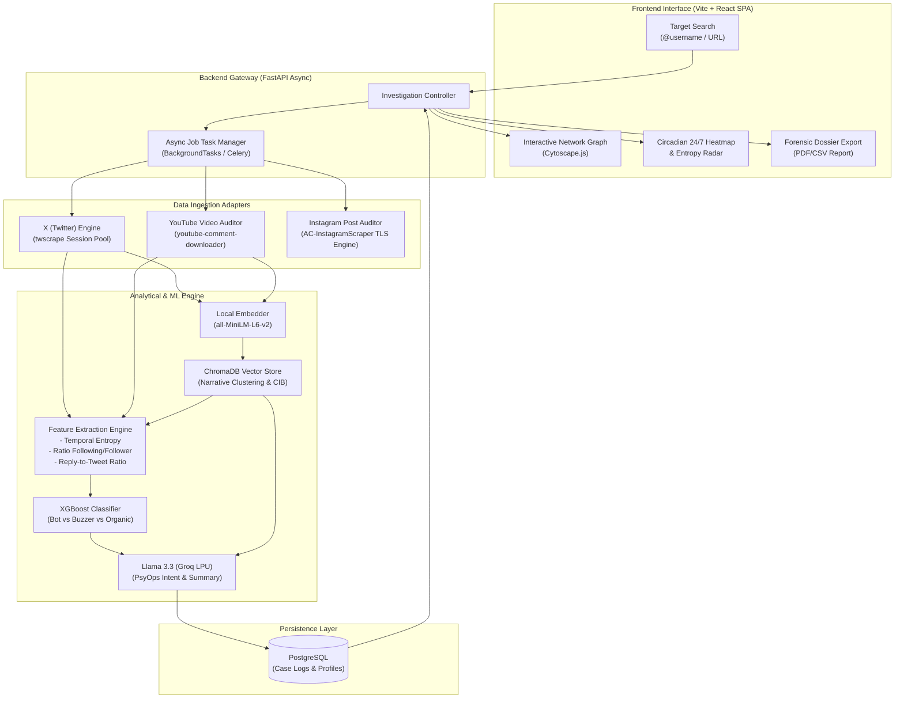
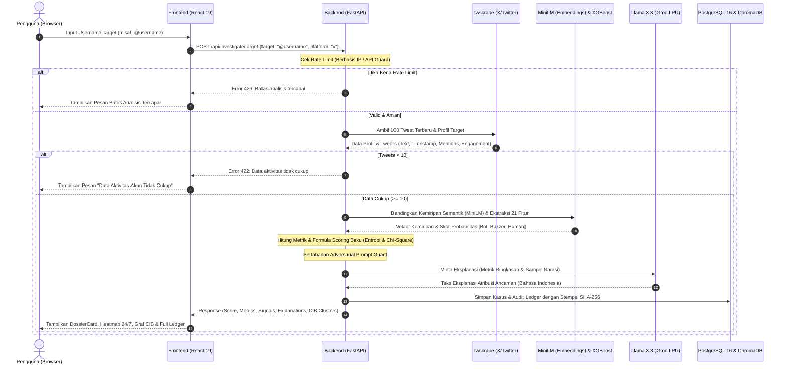
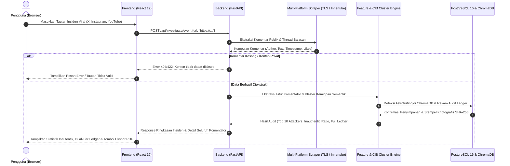
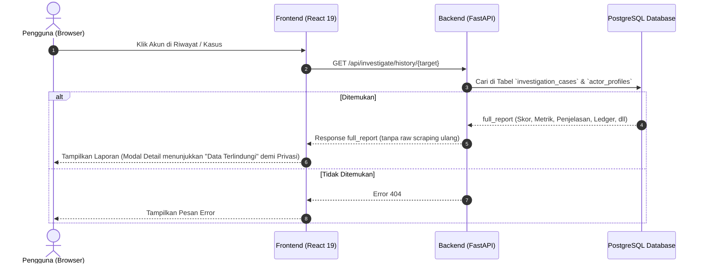

# 📋 Product Requirements Document — Axiom / Project Axiom (PRD-Axiom)
# Cognitive Domain Threat Intelligence & Inauthentic Behavior Detection Platform
### Satuan Acuan: Pusat Siber TNI AD (PUSSIBERAD) — Kategori 04: Cognitive Domain (Siber Sosial)

> **Kode Proyek / Identitas:** Project Axiom  
> **Tagline:** *"Unveiling the Truth in the Cognitive Battlefield."*  
> **Repositori Target:** `axiom` (Monorepo)  
> **Konteks Kompetisi:** Kartika Cyber Hackathon 2026 (PUSSIBERAD & CODEPOLITAN)  
> **Kategori:** 04 Cognitive Domain — Sub-kategori: *Buzzer/Bot Detection, Social Network Analysis, PsyOps Early Warning*  
> **Arsitektur Utama:** Vite + React 19 SPA (Frontend) + FastAPI Async Core + ChromaDB (Vector Store) + PostgreSQL + XGBoost & Groq Llama 3  
> **Biaya Operasional (Cost Target):** 100% Free-Tier / Open-Source Tooling (Zero External API Cost for MVP)  
> **Status Dokumen:** Acuan Tunggal Spesifikasi Sistem (Source of Truth MVP)

---

## 1. Visi, Latar Belakang & Ruang Lingkup Sistem

### 1.1 Visi Produk (Product Vision) & Filosofi Nama
Menyajikan platform intelijen dan forensik ruang siber sosial yang berkemampuan mendeteksi, mengklasifikasikan, dan memetakan aktor inautentik (**Bot**, **Buzzer/Astroturfer**, dan **Manusia Autentik**) serta operasi pengaruh (*Psychological Operations / PsyOps*) secara *real-time*, akurat, dan berbasis bukti otentik (*Explainable AI*) tanpa ketergantungan pada API berbayar mahal.

**Filosofi Project Axiom:**  
"Aksioma" (Axiom) mencerminkan kebenaran dasar yang tidak perlu dibuktikan lagi. Proyek ini bertujuan menjadi landasan absolut dalam menemukan fakta di tengah kebisingan disinformasi, kampanye buzzer, dan manipulasi kognitif di ruang siber. Kami percaya bahwa di balik setiap narasi terkoordinasi, terdapat jejak perilaku yang dapat diverifikasi secara empiris.

### 1.2 Batasan Ruang Lingkup (Scope & Boundaries)
Berdasarkan realitas arsitektur media sosial publik dan kebutuhan kompetisi PUSSIBERAD:
1. **Fokus Platform & Pola Akses Data (Jujur & Teruji):**
   * **X (Twitter) — Deep-Dive Target Actor Profiling:**
     * Input: `@username` target tunggal.
     * Log yang ditarik: Tweet orisinal, repost/retweet, riwayat balasan (*replies*), target interaksi, dan stempel waktu (*timestamp*) 100–300 aktivitas terakhir.
     * Ekstraksi gratis memanfaatkan session scraper (`twikit` / headless session pool) tanpa biaya langganan X API Enterprise ($100+/bln).
   * **YouTube & Instagram — Crisis Response / Event Auditing:**
     * Input: URL Video YouTube atau URL Postingan Publik Instagram.
     * Log yang ditarik: Seluruh komentar publik pada postingan/video tersebut untuk mendeteksi apakah terjadi serbuan botnet terkoordinasi (*coordinated comment flooding*).
     * YouTube menggunakan youtube-comment-downloader (Innertube pure HTTP streaming tanpa API key & tanpa login) dengan fallback YouTube Data API v3; Instagram ditenagai arsitektur Multi-Tier dengan AC-InstagramScraper (Zero-Auth TLS Impersonation via curl_cffi) sebagai engine primer, serta fallback Instaloader session & contextual resilience.
   * **BATASAN TEGAS:** Sistem **TIDAK MENJANJIKAN** pelacakan riwayat komentar keluar (*outgoing comments*) per-username di YouTube, Instagram, atau Facebook karena batasan privasi arsitektur platform tersebut (*walled garden*).
2. **Kemandirian Infrastruktur (Air-Gapped & On-Premise Ready):**
   * Core AI pipeline (XGBoost + Embedding `all-MiniLM-L6-v2`) dapat berjalan 100% lokal di CPU/GPU mandiri tanpa mengirim data intelijen sensitif ke server luar, memenuhi standar operasional militer PUSSIBERAD.

### 1.3 Glosarium Istilah Intelijen Siber
* **Cognitive Warfare:** Perang asimetris yang menargetkan domain kognitif publik untuk memanipulasi opini, memicu polarisasi, dan menurunkan legitimasi institusi.
* **Astroturfing (Buzzer Terkoordinasi):** Praktik memanipulasi persepsi publik dengan menciptakan ilusi seolah-olah ada gerakan akar rumput (*grassroots*) massal, padahal dikomandoi oleh segelintir aktor bayaran.
* **CIB (Coordinated Inauthentic Behavior):** Pola di mana sekelompok akun bekerja sama secara serentak menyebarkan narasi tertentu dalam jendela waktu sempit.
* **Explainable Threat Evidence (XAI):** Bukti forensik berbasis fitur terukur yang menjelaskan dasar pemberian label ancaman (bukan sekadar angka probabilitas *black-box*).
* **Entropy Timestamp:** Ukuran keacakan interval waktu antar-postingan untuk membedakan skrip otomatis (entropi rendah) dari ritme manusiawi (entropi tinggi).

---

## 2. Konsolidasi Tech Stack & Lingkungan Kerja

Seluruh komponen teknologi dipilih dengan pertimbangan **kinerja tinggi, kompatibilitas on-premise, dan nol biaya lisensi (100% Free)**:

### 2.1 Matriks Teknologi

| Layer / Kategori | Komponen Teknologi | Versi / Spesifikasi | Peran & Justifikasi Teknis |
| :--- | :--- | :--- | :--- |
| **Frontend Framework** | **Vite + React (SPA)** | React v19 / TS 5.x / Vite 8 | Web dashboard ultra-cepat, zero SSR overhead, optimal untuk visualisasi graf dan data SOC |
| **Styling & UI Kit** | **Tailwind CSS & Lucide Icons**| Tailwind v4 | UI bernuansa *Cyber Defense Dark/Military Glassmorphism* yang profesional |
| **Visualisasi Graf** | **React Flow (@xyflow/react) / Cytoscape.js** | v12.x / v3.x | Visualisasi interaktif simpul jaringan aktor (*Social Network Graph*) & kluster CIB |
| **Visualisasi Metrik**| **Apache ECharts & Recharts** | ECharts v6 / React v3 | Heatmap aktivitas 24/7, grafik entropi waktu, dan radar chart perilaku |
| **Data Fetching / Polling**| **TanStack Query** | v5.x | Polling asynchronous investigation task & cache state management |
| **Dossier Export** | **@react-pdf/renderer** | v4.x (Client-side) | Pembuatan berkas PDF resmi instan langsung dari browser tanpa beban server |
| **Backend Engine** | **FastAPI (Python)** | v0.115.11 / Starlette 0.46.2 / Py 3.11/3.12 | Asynchronous high-throughput processing, Pydantic v2 validation, hardened against multipart CVE-2024-47874 & ReDoS |
| **Database Relasional**| **PostgreSQL** | v16+ (Docker) | Penyimpanan log kasus, profil target, hasil scoring, dan audit trail |
| **Vector Database** | **ChromaDB** | v0.5.20 / Server v0.5.5 | Indexing dan pencarian semantic similarity copypasta antar-cuitan |
| **Scraping Adapters** | **twscrape**, **youtube-comment-downloader**, **AC-InstagramScraper**, **instaloader** | Open-source Multi-Platform Engine | Ingesti multi-platform tanpa biaya langganan: X (cookie session pool), YouTube (Innertube HTTP parser), dan Instagram (Zero-Auth TLS Impersonation + Instaloader Session Fallback) |
| **ML Classifier** | **XGBoost & Scikit-Learn** | v2.1.3 / v1.5.2 | Klasifikasi tabular 3-kelas (*Bot, Buzzer, Manusia*) dalam <50ms |
| **NLP Embeddings** | **Sentence-Transformers** | `all-MiniLM-L6-v2` / v3.3.1 | Embedding semantik 384-dimensi lokal (cepat, hemat RAM, akurat) |
| **Narrative LLM** | **Llama 3.3 70B via Groq** | Free Tier API (<1s inference) | Sintesis narasi intelejen, deteksi framing isu, dan perangkum laporan |

### 2.2 Konfigurasi Environment (`.env.example`)

```env
# AI Synthesis & Explainable XAI (Groq LPU Llama 3.3)
GROQ_API_KEY=gsk_your_groq_api_key_here
GROQ_MODEL=llama-3.3-70b-versatile
GROQ_FALLBACK_MODEL=llama-3.1-8b-instant

# X (Twitter) Scraper (1 Akun Burner Aman via Browser Cookies)
TWITTER_USERNAME=your_username
TWITTER_AUTH_TOKEN=your_auth_token_cookie
TWITTER_CT0=your_ct0_cookie

# Instagram Scraper (1 Akun Burner Aman via Session ID)
INSTAGRAM_SESSIONID=your_sessionid_cookie
INSTAGRAM_SETTINGS_PATH=data/sessions/ig_settings.json

# Database & Vector Store Connections
POSTGRES_USER=postgres
POSTGRES_PASSWORD=postgres
POSTGRES_DB=axiom_db
POSTGRES_HOST=postgres
POSTGRES_PORT=5432
POSTGRES_HOST_PORT=5434
CHROMA_HOST=chromadb
CHROMA_PORT=8000
CHROMA_COLLECTION_NAME=actor_narratives

# Scraper Operation Mode
SCRAPER_OFFLINE_MODE=false
```

---

## 3. Arsitektur Komunikasi Data & Pipeline Deteksi Forensik

Sistem menerapkan arsitektur *Pipeling Tiga Tingkat (Tri-Tier Analytical Pipeline)* yang mengisolasi ekstraksi data, pemrosesan fitur AI, dan penyajian intelijen:



### 3.1 Diagram Alur Analisis Baru (Request Flow - Target Profiling)
Berikut adalah visualisasi alur request ketika pengguna melakukan analisis investigasi akun target baru:



### 3.2 Diagram Alur Audit Konten / Insiden Viral (Event Auditing Flow)
Berikut adalah alur saat pengguna mengaudit tautan postingan viral lintas platform (X Tweet, Instagram Post/Reels, YouTube Video/Shorts):



### 3.3 Diagram Alur Mengambil Riwayat (History Flow)
Berikut adalah alur saat pengguna mengeklik akun dari papan riwayat investigasi / leaderboard (tanpa scraping ulang):



---

## 4. Matriks Pemetaan Fitur Sistem (F-01 s.d. F-08)

Seluruh fungsionalitas dirancang memenuhi standar penilaian kompetisi PUSSIBERAD:

| Kode | Nama Fitur | Level Prioritas | Target Output | Keterangan Fungsional |
| :---: | :--- | :---: | :--- | :--- |
| **F-01** | **Target Actor Profiling (X Engine)** | **Must-Have** | Profil Akun & Riwayat | Membedah @username X: riwayat tweet, balasan (*replies*), repost, dan akun yang paling sering diserbu/didukung. |
| **F-02** | **Crisis Event Auditing (YT/IG/X)** | **Must-Have** | Infiltration Audit | Membedah satu URL postingan/video viral dan memetakan rasio keterlibatan akun inautentik pada kolom komentar. |
| **F-03** | **Tri-Class Scoring Engine** | **Must-Have** | Skor 0–100% & Kategori | Menghasilkan probabilitas klasifikasi presisi: **Bot (Automated)**, **Buzzer (Astroturfer)**, atau **Manusia (Organik)**. |
| **F-04** | **Coordinated Inauthentic Behavior (CIB)**| **High** | Network Cluster Graph | Memetakan kolaborasi antar-akun (kesamaan narasi serentak, waktu identik, target serbuan sama). |
| **F-05** | **Circadian Heatmap & Entropy Analysis** | **High** | Visual Heatmap 24/7 | Menampilkan jadwal aktif 24 jam x 7 hari untuk mendeteksi *working hours* buzzer bayaran vs skrip bot 24 jam. |
| **F-06** | **Explainable AI (XAI) Threat Dossier** | **Must-Have** | Evidence Card | Penjelasan logis mengapa akun dicap berbahaya: *"Indikator 1: 87% tweet memuji subjek X, Indikator 2: Entropi waktu mendekati 0"*. |
| **F-07** | **Official Dossier Export (PDF/CSV)** | **Must-Have** | Berkas Forensik Siap Pakai| Ekspor berkas laporan intelijen lengkap dengan stempel verifikasi untuk barang bukti tindak lanjut satuan siber. |
| **F-08** | **Watchlist & Early Warning Alert** | **Medium** | Panel Pemantauan Berkala | Menyimpan daftar akun target ancaman tinggi untuk dipantau lonjakan aktivitasnya secara otomatis. |

---

## 5. Logika & Formula Deteksi: Bot vs Buzzer vs Manusia

Untuk memastikan model tidak menjadi *black box*, sistem membedakan ketiga kelas menggunakan indikator kuantitatif berikut:

### 5.1 Kriteria Taksonomi 3-Kelas

```text
+---------------------+-------------------------------+-----------------------------------+--------------------------------+
| Dimensi Pengujian   | BOT (Automatisasi Murni)      | BUZZER (Astroturfer / Cyber Army) | MANUSIA (Akun Organik)         |
+---------------------+-------------------------------+-----------------------------------+--------------------------------+
| Entropi Waktu       | Rendah (Jadwal presisi/tetap) | Sedang-Tinggi (Pola jam kerja)    | Alami (Acak, ada jeda istirahat|
| Jam Operasional     | 24 Jam nonstop tanpa henti    | Dominan Pukul 08.00–18.00 WIB     | Tersebar wajar, malam istirahat|
| Variasi Topik       | Sangat Rendah (1-2 isu saja)  | Rendah (Fokus agenda kampanye)    | Tinggi (Hobi, curhat, opini)   |
| Keragaman Bahasa    | Copypasta template kaku       | Variasi parafrase berulang        | Fleksibel, banyak bahasa gaul  |
| Target Interaksi    | Broadcast / Spam acak         | Menyerbu tokoh/isu spesifik       | Relasional dengan teman/mutual |
| Nilai Rasio Teman   | Following ekstrem / No Follower| Following tinggi, Follower sedang | Rasio seimbang & wajar         |
+---------------------+-------------------------------+-----------------------------------+--------------------------------+
```

### 5.2 Formulasi Ekstraksi Fitur (Feature Engineering Matrix)

1. **Temporal Entropy ($H_t$):**
   $$H_t = -\sum_{i=1}^{n} P(\Delta t_i) \log_2 P(\Delta t_i)$$
   *Keterangan:* Mengukur variasi selang waktu antar-cuitan ($\Delta t$). Nilai $H_t < 1.5$ mengindikasikan kuat otomasi bot.
2. **Target Concentration Ratio ($C_{target}$):**
   $$C_{target} = \frac{\text{Jumlah interaksi pada topik / figur sentral}}{\text{Total seluruh interaksi akun}}$$
   *Keterangan:* Jika $C_{target} > 0.75$, akun memiliki indikasi kuat sebagai partisan/buzzer agenda tunggal.
3. **Semantic Duplication Score ($S_{semantic}$ via ChromaDB):**
   Cosine similarity dihitung terhadap cuitan 100 akun lain dalam jendela waktu 30 menit. Jika $S_{semantic} > 0.85$ dengan kata berbeda, terdeteksi operasi parafrase terkoordinasi (*CIB*).

---

## 6. Spesifikasi Kontrak API Core (`FastAPI`)

Seluruh komunikasi backend menggunakan format JSON terstruktur:

### 6.1 Daftar Endpoint Utama

| Method | Endpoint | Peran & Deskripsi | Payload / Parameter |
| :---: | :--- | :--- | :--- |
| `POST` | `/api/v1/auth/login` | Otentikasi operator & penerbitan Bearer JWT Token (RBAC) | `{"username": "nrp/id", "password": "..."}` |
| `GET` | `/api/v1/auth/me` | Verifikasi profil & hak akses peran operator aktif | Header: `Authorization: Bearer <token>` |
| `POST` | `/api/v1/investigate/target` | Memulai analisis target (Username / URL tervalidasi & Anti-SSRF) | `{"platform": "x", "target": "akun", "max_interactions": 200}` |
| `GET` | `/api/v1/investigate/{case_id}` | Mengambil status pemrosesan & hasil investigasi | Path param: `case_id` |
| `GET` | `/api/v1/network/graph/{case_id}`| Mengambil data simpul (*nodes & edges*) untuk Cytoscape | Query param: `min_confidence=0.7` |
| `GET` | `/api/v1/export/report/{case_id}` | Mengunduh berkas laporan resmi PDF/CSV | Query param: `format=pdf\|csv` |
| `GET` | `/api/v1/watchlist` | Mendapatkan daftar aktor dalam pantauan khusus | Query param: `tag=psyops` |

### 6.2 Contoh Payload Respons Intelijen (`GET /api/v1/investigate/{task_id}`)

```json
{
  "status": "completed",
  "data": {
    "target": "@infiltrator_01",
    "platform": "x",
    "classification": {
      "predicted_class": "BUZZER",
      "confidence": 0.912,
      "class_probabilities": {
        "bot": 0.048,
        "buzzer": 0.912,
        "human": 0.040
      }
    },
    "metrics": {
      "temporal_entropy": 2.14,
      "active_hours_peak": "09:00 - 17:00 WIB",
      "target_bias_score": 0.884,
      "cluster_similarity_score": 0.891
    },
    "threat_attribution": {
      "threat_level": "HIGH",
      "primary_agenda": "Delegitimasi Kebijakan Pertahanan Siber Nasional",
      "evidence_points": [
        "Aktivitas 88% terkonsentrasi hanya membalas tweet institusi tertentu dalam 7 hari terakhir.",
        "Terdeteksi 14 cuitan dengan struktur semantik identik (paraphrased copypasta) bersama 8 akun lain.",
        "Pola jam aktif berulang secara konsisten pada hari kerja (pukul 08.30 - 17.30 WIB)."
      ]
    },
    "top_targets": [
      { "username": "@TNI_AD", "interaction_count": 42 },
      { "username": "@Kemhan_RI", "interaction_count": 31 }
    ]
  }
}
```

---

## 7. Desain Antarmuka (Cyber Defense UI Theme)

### 7.1 Identitas Visual & Palet Warna Status
Mengadopsi tema **Military Cyber Threat Center (Dark Glassmorphism)**:

* **Background Utama:** `#0B0F19` (Deep Navy Black — fokus ruang kontrol)
* **Surface Panel / Card:** `#111827` dengan border tipis `#1F2937`
* **Brand Primary (Accent):** `#06B6D4` (Cyan Cyber Tech) & `#3B82F6` (Electric Blue)
* **Status Badges Semantik:**
  * **HUMAN / AUTHENTIC:** `#10B981` (Emerald-500 — Aman)
  * **SUSPICIOUS / BUZZER:** `#F59E0B` (Amber-500 — Waspada Opini)
  * **BOT / THREAT ACTOR:** `#EF4444` (Rose-500 — Bahaya Infiltrasi)

### 7.2 Struktur Layout Dashboard Utama
1. **Top Threat Bar:** Pencarian cepat target (`@username` atau URL) + Status Operasional Scraping Pool.
2. **Actor Summary Card:** Foto profil target, status klasifikasi tri-kelas dengan badge besar, dan tombol *Generate Official Dossier*.
3. **Dual Insight Grid:**
   * *Sisi Kiri:* Heatmap aktivitas 24/7 (menyorot pola jam kerja) & Grafik Radar Perilaku.
   * *Sisi Kanan:* Interactive Network Graph (memperlihatkan hubungan target dengan kluster buzzer lainnya).
4. **Forensic Evidence Stream:** Tabel log cuitan/balasan beserta anotasi AI yang menandai pesan mana saja yang terindikasi copypasta.

---

## 8. Definition of Done (DoD) & Matriks Pengujian MVP

Sebuah milestone purwarupa dinyatakan selesai dan layak diajukan ke dewan juri jika:

| No | Modul Uji | Target Verifikasi | Tolok Ukur Keberhasilan |
| :---: | :--- | :--- | :--- |
| 1 | **X Scraping Ingestion** | Engine `twscrape` session | Mampu menarik 150+ tweet & replies dari username publik tanpa error rate-limit. |
| 2 | **Inference Latency** | Pipeline XGBoost + Chroma | Menghasilkan skor klasifikasi dan kesamaan vektor dalam waktu $< 3.5$ detik. |
| 3 | **LLM Synthesis via Groq** | Llama 3.3 70B | Menghasilkan narasi pembuktian bukti ancaman (*evidence points*) dalam waktu $< 2.0$ detik. |
| 4 | **Tri-Class Accuracy** | Labeled Benchmark Dataset | Mencapai akurasi deteksi $> 88\%$ pada set data uji bot, buzzer, dan akun organik. |
| 5 | **Network Visualization** | Cytoscape.js Renderer | Menampilkan minimal 20 simpul akun yang berinteraksi dengan layout visual lancar (60 FPS). |
| 6 | **Document Export** | Client PDF Generator (@react-pdf/renderer)| Menghasilkan berkas PDF rapi berisi ringkasan kasus, grafik, dan bukti forensik. |
| 7 | **Zero API Cost Run** | Seluruh komponen sistem | Beroperasi penuh pada lingkungan pengujian tanpa ada tagihan API berbayar. |

---

## 9. Rencana Eksekusi Menuju Deadline 15 November 2026

Mengacu pada jadwal resmi **Kartika Cyber Hackathon 2026**:

* **Minggu 1 (25 Okt – 31 Okt 2026) — Core Foundation & Ingestion:**
  * Inisialisasi monorepo: FastAPI backend + Vite React SPA UI + Docker Compose (PostgreSQL, ChromaDB, FastAPI, Nginx).
  * Implementasi wrapper `twscrape` scraper pool untuk penarikan data X bebas blokir.
  * Setup ChromaDB lokal dan pipeline embedding `all-MiniLM-L6-v2`.
* **Minggu 2 (01 Nov – 07 Nov 2026) — Detection Engine & Analytics:**
  * Pembangunan formula ekstraksi fitur (Entropi waktu, konsentrasi target, copypasta cluster).
  * Pelatihan model XGBoost ringan untuk klasifikasi tri-kelas.
  * Integrasi Groq API (Llama 3.3) untuk *Explainable Threat Attribution*.
* **Minggu 3 (08 Nov – 12 Nov 2026) — Interactive UI & Network Graph:**
  * Integrasi Cytoscape.js untuk visualisasi hubungan aktor terkoordinasi.
  * Pembangunan komponen Heatmap 24/7 dan Evidence Dossier Card.
  * Implementasi fitur ekspor PDF/CSV.
* **Minggu 4 (13 Nov – 15 Nov 2026) — Final Polish & Submission:**
  * Pengambilan video demo purwarupa (screen recording interaktif + voiceover).
  * Penyusunan slide presentasi teknis dengan narasi militer PUSSIBERAD.
  * **Final Submission pada portal CODEPOLITAN (Sebelum 15 November 2026 pukul 23:59 WIB).**

---

## 9.1 Fitur Tambahan Terverifikasi (Production Hardening & CI/CD)

1. **Live Guest Demo Sandbox (Platform X):**
   * Pengujian langsung di Landing Page tanpa login menggunakan live scraper `twscrape` (10–400 sampel) dengan streaming progress orkestrator dan penjelasan XAI.
   * Pencatatan audit trail yang diagregasikan sebagai `GUEST` tanpa merekam data privat pengunjung.

2. **Ekspansi 6-Kanal Forensik & Deep Scraping:**
   * **X Cuitan (Status):** Penelusuran pohon percakapan lengkap (*conversation tree*) mencakup balasan langsung dan percakapan berantai (*nested thread replies*).
   * **YouTube Video & Shorts:** Ekstraksi komentar beserta seluruh balasan bertingkat (*nested replies*).
   * **Instagram Reels & Post:** Scraper zero-auth dengan pembatasan ketat di 200 sampel untuk menjamin stabilitas IP scraper terhadap rate limiting Meta.
   * **Pilihan Kuota Sampel:** 100, 150, 200, dan 400 Sampel (*Deep Audit*), dengan auto-clamp 200 untuk Instagram.

3. **Secure Image Proxy Service (`/api/v1/investigate/proxy-image`):**
   * Endpoint internal terisolasi untuk menyalurkan aset gambar dari CDN Meta/Instagram dengan injeksi header `Cross-Origin-Resource-Policy: cross-origin` guna mengatasi pemblokiran rendering gambar pada browser modern.

4. **Dual-Tier Attacker Ledger & Verified Comment Evidence:**
   * Menampilkan bukti kutipan nyata teks komentar yang ditulis oleh Top 10 Penyerang Inti untuk verifikasi faktual tim analis.

5. **CI/CD Pipeline, Registry GHCR, & Auto-Deployment VPS:**
   * Workflow rilis otomatis khusus branch `main` (`release-ghcr.yml`) yang mem-build image Docker dan menerbitkan GitHub Release dengan auto-generated changelog.
   * Workflow deployment zero-downtime (`deploy-vps.yml`) dengan *safety guard* (`if: secrets.VPS_HOST != ''`) sehingga tidak gagal saat rahasia VPS belum dipasang.

---

## 10. Rencana Pembaruan Potensial (Potential Future Updates)

Peta jalan pengembangan strategis pasca-MVP untuk kesiapan operasional pertahanan siber kognitif tingkat lanjut:

1. **🌐 Ekspansi Ekosistem OSINT Lintas Platform:**
   - Penambahan ingesti dan parsing komentar video tren platform **TikTok** dan manipulasi tagar.
   - Pemantauan linimasa percakapan kanal publik **Telegram** dan mikroblog **Threads**.
   - Penarikan halaman publik Facebook dan forum komunitas daring regional.

2. **🧠 On-Premise Defense Domain SLM (Small Language Model):**
   - Fine-tuning model bahasa terbuka ringkas (Llama 3.1 8B / Mistral NeMo 12B) dengan korpus terminologi siber-militer Indonesia dan bahasa percakapan lokal (*slang/singkatan buzzer*).
   - Memfasilitasi instalasi *air-gapped* 100% mandiri tanpa koneksi internet luar untuk fasilitas ruang kendali militer rahasia (*secure command center / SOC PUSSIBERAD*).

3. **⚡ Telemetri Ancaman Real-Time & Live Battle-Room Streaming:**
   - Integrasi arsitektur streaming pesan **Apache Kafka** / **Redis Streams** untuk menyerap dan menganalisis lonjakan narasi propaganda dalam skala masif.
   - Dashboard situasi taktis (*Live Tactical Situation Map*) dengan notifikasi alert instan via webhook terenkripsi ke SIEM/SOC pertahanan siber.

4. **🛡️ Automated Counter-Narrative & Cognitive Inoculation:**
   - Modul perancang narasi tandingan berbasis fakta (*evidence-backed rebuttal generator*) yang terverifikasi secara ilmiah untuk menetralkan disinformasi sebelum mencapai saturasi viral.
   - Peringatan dini berbasis *pre-bunking* untuk memperkuat literasi dan ketahanan kognitif publik terhadap pola kampanye astroturfing yang terdeteksi.

5. **🔗 Desentralisasi Ledger Bukti Digital (Verifiable Cryptographic Proofs):**
   - Peningkatan rantai bukti digital SHA-256 menuju pencatatan terdistribusi berbasis *Private Permissioned Ledger* untuk menjamin barang bukti forensik digital tidak dapat disangkal (*non-repudiation*) di ranah hukum peradilan militer atau tindak pidana siber.

6. **🚨 Otomasi Pelaporan & Takedown Terintegrasi CSIRT:**
   - Ekspor otomatis berkas insiden berstandar format **STIX/TAXII 2.1** untuk integrasi langsung dengan platform CERT/CSIRT nasional (BSSN) dan penyedia layanan platform sosial.

---

*Dipersiapkan untuk:*  
**Kartika Cyber Hackathon 2026 — Pusat Siber Angkatan Darat (PUSSIBERAD) & CODEPOLITAN**  
*Mendukung Kedaulatan Ruang Siber Nasional Melalui Keunggulan Domain Kognitif.* 🛡️🇮🇩